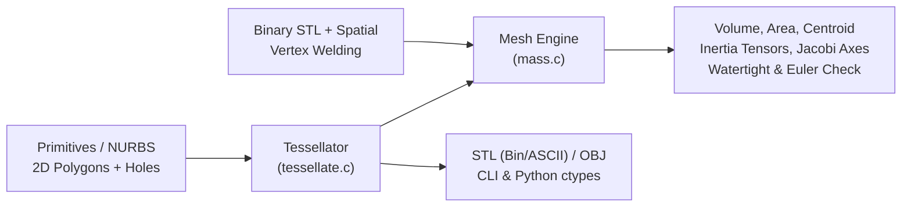

<div align="center">

<picture>
  <source media="(prefers-color-scheme: dark)" srcset="assets/logo-dark.svg">
  <source media="(prefers-color-scheme: light)" srcset="assets/logo-light.svg">
  
</picture>

**Zero-dependency C99 library, CLI, and Python `ctypes` wrapper for B-rep mesh mass properties, inertia tensors, polygon/NURBS tessellation & STL/OBJ I/O.**

**English** · [Русский](docs/i18n/README.ru.md) · [中文](docs/i18n/README.zh-CN.md) · [Deutsch](docs/i18n/README.de.md) · [日本語](docs/i18n/README.ja.md) · [Español](docs/i18n/README.es.md)

[](https://github.com/41Opty41/brepmass/actions/workflows/ci.yml)
[-EA580C?style=flat-square)](CMakeLists.txt)
[](CMakeLists.txt)
[](LICENSE)
[](DONATE.md)

</div>

---

## Architecture



## Features

- **Pure C99 (`-std=c99 -Wall -Wextra -Werror`)** — requires only `libc` and `libm`.
- **Exact mass & inertia integrals** — divergence-theorem tetrahedral flux integration for closed solids, surface integration (`dim=2`) for open sheets, parallel-axis theorem centroid shift, and cyclic Jacobi eigensolver for principal moments and axes.
- **Topology checks** — directed half-edge twin pairing (`is_closed`) and Euler characteristic `V - E + F`.
- **Analytic reference solvers** — `bm_analytic_box`, `bm_analytic_cylinder`, `bm_analytic_cone_frustum`, `bm_analytic_sphere`, `bm_analytic_torus`.
- **Watertight tessellators** — primitives, 2D ear-clipping with arbitrary holes (`bm_tessellate_polygon_2d`), and rational/non-rational Cox–de Boor NURBS surfaces (`bm_tessellate_nurbs_patch`).
- **Mesh I/O & bindings** — binary/ASCII STL, spatial-hash vertex-welding binary STL reader, Wavefront OBJ, CLI `brepmass`, and zero-dependency [`python/brepmass.py`](python/brepmass.py).

## Quick Start

### Build with CMake

```bash
cmake -B build -DCMAKE_BUILD_TYPE=Release
cmake --build build --config Release
ctest --test-dir build -C Release --output-on-failure
```

### CLI

```bash
brepmass make cylinder 0.5 2.0 -o cylinder.stl
brepmass info cylinder.stl --density 7850
```

### Python (`ctypes`)

```python
from python.brepmass import tessellate_box, mesh_mass_props

verts, tris = tessellate_box(2.0, 3.0, 4.0)
props = mesh_mass_props(verts, tris, density=2.0)
print(props.volume, props.centroid, props.principal_moments)
```

## API Overview

| Module | Key Functions |
| --- | --- |
| [`mass.c`](src/mass.c) | `bm_mesh_mass_props`, `bm_mesh_is_closed`, `bm_analytic_*` |
| [`tessellate.c`](src/tessellate.c) | `bm_tessellate_box/cylinder/cone_frustum/sphere/torus`, `bm_tessellate_polygon_2d`, `bm_tessellate_nurbs_patch` |
| [`io_mesh.c`](src/io_mesh.c) | `bm_write_stl_binary`, `bm_read_stl_binary`, `bm_write_stl_ascii`, `bm_write_obj` |
| [`brepmass.h`](include/brepmass.h) | Public C99 header (`BM_API` DLL/shared-lib ready) |

## Documentation

- [Mathematical Derivations](docs/MATH.md) ([Русская версия](docs/i18n/MATH.ru.md))
- [Contributing](CONTRIBUTING.md) · [Changelog](CHANGELOG.md)

## Support

If `brepmass` helps your work, voluntary donations are welcome ([details](DONATE.md)):
- **Bitcoin (BTC)**: `bc1qqptjmpr684xglyqsp743ruufnwpsjv4dlzk9tx`
- **YooMoney**: [yoomoney.ru/to/4100118415983435](https://yoomoney.ru/to/4100118415983435) (`4100118415983435`)

## License

MIT License — see [`LICENSE`](LICENSE).
