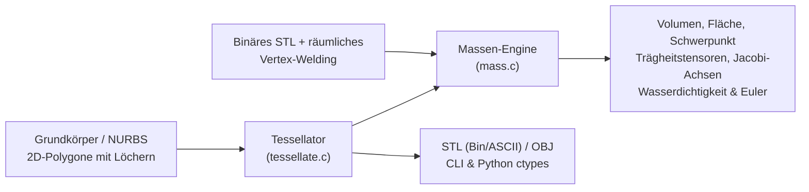

<div align="center">

<picture>
  <source media="(prefers-color-scheme: dark)" srcset="../../assets/logo-dark.svg">
  <source media="(prefers-color-scheme: light)" srcset="../../assets/logo-light.svg">
  
</picture>

**Abhängigkeitsfreie C99-Bibliothek, CLI und Python-`ctypes`-Anbindung für Masseeigenschaften, Trägheitstensoren, Polygon-/NURBS-Tessellierung & STL/OBJ-I/O.**

[English](../../README.md) · [Русский](README.ru.md) · [中文](README.zh-CN.md) · **Deutsch** · [日本語](README.ja.md) · [Español](README.es.md)

[-EA580C?style=flat-square)](../../CMakeLists.txt)
[](../../CMakeLists.txt)
[](../../LICENSE)
[](../../DONATE.md)

</div>

---

## Architektur



## Funktionen

- **Reines C99 (`-std=c99 -Wall -Wextra -Werror`)** — benötigt nur `libc` und `libm`.
- **Exakte Massen- & Trägheitsintegrale** — Tetraeder-Flussintegration nach dem Gaußschen Integralsatz für geschlossene Körper, Flächenintegrale (`dim=2`) für offene Schalen, Satz von Steiner und zyklisches Jacobi-Verfahren für Hauptträgheitsmomente und -achsen.
- **Topologieprüfung** — Paarung gerichteter Halbkanten (`is_closed`) und Euler-Charakteristik `V - E + F`.
- **Analytische Referenzfunktionen** — Quader, Zylinder, Kegelstumpf, Kugel und Torus (`bm_analytic_*`).
- **Wasserdichte Tessellierung & I/O** — Grundkörper, 2D-Ear-Clipping mit beliebigen Löchern, rationale/nicht-rationale Cox-de-Boor-NURBS sowie binäres/ASCII STL (inkl. Vertex-Welding) und Wavefront OBJ.

## Schnellstart

```bash
cmake -B build -DCMAKE_BUILD_TYPE=Release
cmake --build build --config Release
ctest --test-dir build -C Release --output-on-failure
```

```bash
brepmass make cylinder 0.5 2.0 -o cylinder.stl
brepmass info cylinder.stl --density 7850
```

## Unterstützung

Wenn Ihnen `brepmass` weiterhilft, freuen wir uns über eine freiwillige Spende ([Details](../../DONATE.md)):
- **Bitcoin (BTC)**: `bc1qqptjmpr684xglyqsp743ruufnwpsjv4dlzk9tx`
- **YooMoney**: [yoomoney.ru/to/4100118415983435](https://yoomoney.ru/to/4100118415983435) (`4100118415983435`)

## Dokumentation & Lizenz

- [Mathematische Herleitungen (EN)](../MATH.md) · [Mitwirken](../../CONTRIBUTING.md) · [Changelog](../../CHANGELOG.md)
- MIT-Lizenz — siehe [`LICENSE`](../../LICENSE).
