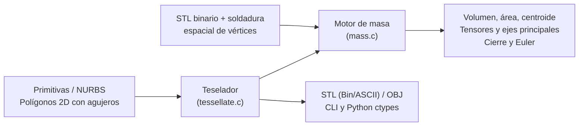

<div align="center">

<picture>
  <source media="(prefers-color-scheme: dark)" srcset="../../assets/logo-dark.svg">
  <source media="(prefers-color-scheme: light)" srcset="../../assets/logo-light.svg">
  
</picture>

**Biblioteca C99 sin dependencias, CLI y wrapper `ctypes` en Python para propiedades másicas, tensores de inercia, teselación NURBS/polígonos y STL/OBJ.**

[English](../../README.md) · [Русский](README.ru.md) · [中文](README.zh-CN.md) · [Deutsch](README.de.md) · [日本語](README.ja.md) · **Español**

[-EA580C?style=flat-square)](../../CMakeLists.txt)
[](../../CMakeLists.txt)
[](../../LICENSE)
[](../../DONATE.md)

</div>

---

## Arquitectura



## Características

- **C99 puro (`-std=c99 -Wall -Wextra -Werror`)** — solo requiere `libc` y `libm`.
- **Integrales exactas de masa e inercia** — flujo tetraédrico por teorema de la divergencia para sólidos cerrados, integrales de superficie (`dim=2`) para láminas abiertas, teorema de Steiner y diagonales de Jacobi para momentos y ejes principales.
- **Comprobación topológica** — emparejamiento de semiaristas orientadas (`is_closed`) y característica de Euler `V - E + F`.
- **Referencias analíticas** — caja, cilindro, tronco de cono, esfera y toro (`bm_analytic_*`).
- **Teselación estanca y E/S** — primitivas, triangulación 2D ear-clipping con agujeros, superficies NURBS racionales/no racionales, STL binario/ASCII (con soldadura por hash espacial) y Wavefront OBJ.

## Inicio rápido

```bash
cmake -B build -DCMAKE_BUILD_TYPE=Release
cmake --build build --config Release
ctest --test-dir build -C Release --output-on-failure
```

```bash
brepmass make cylinder 0.5 2.0 -o cylinder.stl
brepmass info cylinder.stl --density 7850
```

## Apoyar el proyecto

Si `brepmass` te resulta útil, puedes apoyar el desarrollo con una donación voluntaria ([detalles](../../DONATE.md)):
- **Bitcoin (BTC)**: `bc1qqptjmpr684xglyqsp743ruufnwpsjv4dlzk9tx`
- **YooMoney**: [yoomoney.ru/to/4100118415983435](https://yoomoney.ru/to/4100118415983435) (`4100118415983435`)

## Documentación y licencia

- [Derivaciones matemáticas (EN)](../MATH.md) · [Contribuir](../../CONTRIBUTING.md) · [Historial de cambios](../../CHANGELOG.md)
- Licencia MIT — consulta [`LICENSE`](../../LICENSE).
