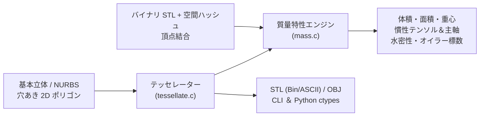

<div align="center">

<picture>
  <source media="(prefers-color-scheme: dark)" srcset="../../assets/logo-dark.svg">
  <source media="(prefers-color-scheme: light)" srcset="../../assets/logo-light.svg">
  
</picture>

**外部依存ゼロの C99 質量特性・慣性テンソル計算、穴あき多角形 / NURBS テッセレーション、STL / OBJ 入出力ライブラリ＆ CLI・Python `ctypes` ラッパー。**

[English](../../README.md) · [Русский](README.ru.md) · [中文](README.zh-CN.md) · [Deutsch](README.de.md) · **日本語** · [Español](README.es.md)

[-EA580C?style=flat-square)](../../CMakeLists.txt)
[](../../CMakeLists.txt)
[](../../LICENSE)
[](../../DONATE.md)

</div>

---

## アーキテクチャ



## 主な機能

- **純粋な C99 (`-std=c99 -Wall -Wextra -Werror`)** — `libc` と `libm` のみでビルド可能。
- **厳密な質量・慣性積分** — 発散定理による閉ソリッドの四面体積分、開シェルの面積分（`dim=2`）、平行軸の定理による重心変換、ヤコビ法による主慣性モーメント・主軸計算。
- **位相検証** — 有向半稜線ペアによる水密判定（`is_closed`）とオイラー標数 `V - E + F`。
- **解析解リファレンス** — 直方体・円柱・円錐台・球・トーラス（`bm_analytic_*`）。
- **水密メッシング＆ I/O** — プリミティブ、任意穴あき 2D イヤー・クリッピング（`bm_tessellate_polygon_2d`）、有理/非有理 NURBS パッチ（`bm_tessellate_nurbs_patch`）、頂点結合付きバイナリ STL 読み込み＆ OBJ 出力。

## クイックスタート

```bash
cmake -B build -DCMAKE_BUILD_TYPE=Release
cmake --build build --config Release
ctest --test-dir build -C Release --output-on-failure
```

```bash
brepmass make cylinder 0.5 2.0 -o cylinder.stl
brepmass info cylinder.stl --density 7850
```

## サポート・寄付

`brepmass` がお役に立ちましたら、任意のご支援をお待ちしております（[詳細](../../DONATE.md)）：
- **Bitcoin (BTC)**: `bc1qqptjmpr684xglyqsp743ruufnwpsjv4dlzk9tx`
- **YooMoney**: [yoomoney.ru/to/4100118415983435](https://yoomoney.ru/to/4100118415983435) (`4100118415983435`)

## ドキュメント・ライセンス

- [数式の導出 (EN)](../MATH.md) · [コントリビュート](../../CONTRIBUTING.md) · [変更履歴](../../CHANGELOG.md)
- MIT ライセンス — [`LICENSE`](../../LICENSE) を参照。
