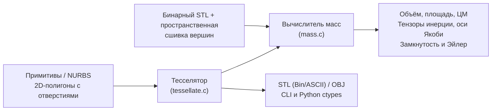

<div align="center">

<picture>
  <source media="(prefers-color-scheme: dark)" srcset="../../assets/logo-dark.svg">
  <source media="(prefers-color-scheme: light)" srcset="../../assets/logo-light.svg">
  
</picture>

**Лёгкая C99-библиотека без зависимостей, CLI и Python `ctypes`-обёртка для расчёта масс-инерционных характеристик B-rep/сеток, тесселяции полигонов и NURBS и работы с STL/OBJ.**

[English](../../README.md) · **Русский** · [中文](README.zh-CN.md) · [Deutsch](README.de.md) · [日本語](README.ja.md) · [Español](README.es.md)

[-EA580C?style=flat-square)](../../CMakeLists.txt)
[](../../CMakeLists.txt)
[](../../LICENSE)
[](../../DONATE.md)

</div>

---

## Архитектура



## Возможности

- **Чистый C99 (`-std=c99 -Wall -Wextra -Werror`)** — требуется только стандартная библиотека C (`libc` и `libm`).
- **Точные интегралы массы и инерции** — тетраэдральное потоковое интегрирование по теореме Гаусса–Остроградского для замкнутых тел, поверхностные интегралы (`dim=2`) для открытых оболочек, перенос тензора инерции к центру масс (теорема Штейнера) и циклический метод Якоби для главных моментов и осей.
- **Топологический контроль** — проверка парности направленных полурёбер (`is_closed`) и характеристика Эйлера `V - E + F`.
- **Аналитические эталоны** — `bm_analytic_box`, `bm_analytic_cylinder`, `bm_analytic_cone_frustum`, `bm_analytic_sphere`, `bm_analytic_torus`.
- **Водонепроницаемые тесселяторы** — базовые примитивы, триангуляция плоских 2D-полигонов с произвольными отверстиями методом ear-clipping (`bm_tessellate_polygon_2d`) и сэмплирование рациональных/нерациональных NURBS-поверхностей (`bm_tessellate_nurbs_patch`).
- **Файловый ввод-вывод и CLI** — бинарный/ASCII STL (со spatial-hash сшивкой вершин при чтении), Wavefront OBJ, утилита `brepmass` и [`python/brepmass.py`](../../python/brepmass.py).

## Быстрый старт

### Сборка через CMake

```bash
cmake -B build -DCMAKE_BUILD_TYPE=Release
cmake --build build --config Release
ctest --test-dir build -C Release --output-on-failure
```

### CLI и Python

```bash
brepmass make cylinder 0.5 2.0 -o cylinder.stl
brepmass info cylinder.stl --density 7850
```

```python
from python.brepmass import tessellate_box, mesh_mass_props

verts, tris = tessellate_box(2.0, 3.0, 4.0)
props = mesh_mass_props(verts, tris, density=2.0)
print(props.volume, props.centroid, props.principal_moments)
```

## Поддержать проект

Если `brepmass` экономит вам время, проект можно добровольно поддержать ([подробнее](../../DONATE.md)):
- **Bitcoin (BTC)**: `bc1qqptjmpr684xglyqsp743ruufnwpsjv4dlzk9tx`
- **ЮMoney**: [yoomoney.ru/to/4100118415983435](https://yoomoney.ru/to/4100118415983435) (кошелёк `4100118415983435`)

## Документация и лицензия

- [Математические формулы и выводы (на русском)](MATH.ru.md) · [English](../MATH.md)
- [Участие в разработке](../../CONTRIBUTING.md) · [История изменений](../../CHANGELOG.md)
- Лицензия MIT — см. [`LICENSE`](../../LICENSE).
