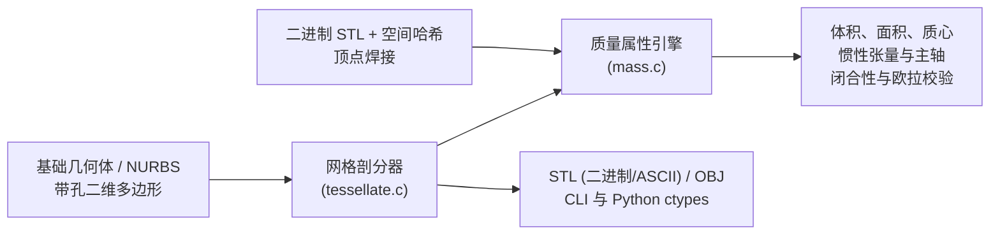

<div align="center">

<picture>
  <source media="(prefers-color-scheme: dark)" srcset="../../assets/logo-dark.svg">
  <source media="(prefers-color-scheme: light)" srcset="../../assets/logo-light.svg">
  
</picture>

**零外部依赖的 C99 几何质量属性库、命令行工具与 Python `ctypes` 封装，支持体积/表面积/质心/惯性张量计算、NURBS 与带孔多边形剖分以及 STL/OBJ 读写。**

[English](../../README.md) · [Русский](README.ru.md) · **中文** · [Deutsch](README.de.md) · [日本語](README.ja.md) · [Español](README.es.md)

[-EA580C?style=flat-square)](../../CMakeLists.txt)
[](../../CMakeLists.txt)
[](../../LICENSE)
[](../../DONATE.md)

</div>

---

## 架构概览



## 核心特性

- **纯 C99 (`-std=c99 -Wall -Wextra -Werror`)** — 仅依赖标准 `libc` 与 `libm`。
- **精确质量与惯性积分** — 基于散度定理的封闭四面体通量积分、开放壳体表面积分（`dim=2`）、平行轴定理质心平移及 Jacobi 特征值主惯性矩/主轴求解。
- **拓扑闭合检查** — 有向半边配对校验（`is_closed`）与欧拉示性数 `V - E + F`。
- **解析几何参考解** — 内置长方体、圆柱、圆台、球体、圆环解析公式（`bm_analytic_*`）。
- **水密网格生成与文件格式** — 支持基本体剖分、带任意内孔二维耳切法（`bm_tessellate_polygon_2d`）、有理/非有理 NURBS 曲面（`bm_tessellate_nurbs_patch`）、带顶点焊接的二进制 STL 读写及 OBJ 导出。

## 快速开始

```bash
cmake -B build -DCMAKE_BUILD_TYPE=Release
cmake --build build --config Release
ctest --test-dir build -C Release --output-on-failure
```

```bash
brepmass make cylinder 0.5 2.0 -o cylinder.stl
brepmass info cylinder.stl --density 7850
```

## 赞助与支持

如果 `brepmass` 对您的工作有所帮助，欢迎自愿捐赠支持开发（[详情](../../DONATE.md)）：
- **Bitcoin (BTC)**：`bc1qqptjmpr684xglyqsp743ruufnwpsjv4dlzk9tx`
- **YooMoney**：[yoomoney.ru/to/4100118415983435](https://yoomoney.ru/to/4100118415983435)（`4100118415983435`）

## 文档与许可证

- [数学推导 (EN)](../MATH.md) · [参与贡献](../../CONTRIBUTING.md) · [更新日志](../../CHANGELOG.md)
- MIT 许可证 — 详见 [`LICENSE`](../../LICENSE)。
